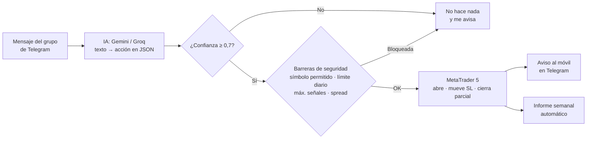

# Bot de señales Telegram → MetaTrader 5

Lee los mensajes de un grupo/canal de Telegram (con tu propia cuenta, no hace falta ser admin), los interpreta con IA **gratuita** (Gemini o Groq) aunque cada mensaje tenga un formato distinto, y abre o gestiona las operaciones en MT5.

> **Proyecto personal de aprendizaje**, probado solo en cuenta demo. No es asesoramiento financiero ni un sistema rentable: es un ejercicio de automatización con IA y de cómo ponerle límites.

## El proyecto en un minuto

**El problema:** los mensajes del grupo llegan cada vez escritos de una forma (`XAUUSD SELL 4127 TP 4124 SL 4177`, `TP1 +30 pips ✅`, `mover el SL a BE`). Copiarlos a mano es lento y da errores.

**La solución:** una IA convierte cada mensaje en una acción concreta en JSON (abrir, mover stop, cerrar parcial...). Si no está segura, no hace nada y avisa.

**Cifras:** 9 archivos de Python (1.364 líneas), montado en dos días con Claude Code. 245 mensajes interpretados en sus primeros días.

### Cómo funciona



<!-- Añade aquí una captura de los avisos del bot en Telegram (sin importes):  -->

### Lo que aprendí

- **Un bot que funciona no es un bot seguro.** Dos copias abiertas a la vez duplicaron una operación. Ahora hay un bloqueo de instancia única.
- **La IA necesita barreras:** confianza mínima, modo simulación, límite de pérdida diaria y lista de símbolos permitidos.
- **Revisar lo que hace la IA:** otra IA (Claude) revisa el registro del bot y propone mejoras. Encontró 7 problemas en 3 días, ninguno había costado dinero todavía.

**Tecnologías:** Python · Telethon · API de Gemini/Groq (compatible OpenAI) · MetaTrader 5 · Claude Code

## Qué hace

- **Abre operaciones**: buy/sell, a mercado, limit o stop, zonas de entrada, varios TP. Si el precio ya se ha ido de la zona, pone una orden limit en vez de perseguir el precio.
- **Lotaje según tu % de riesgo**: calcula el lote con la distancia al SL (lo hace MT5, así que funciona igual con oro, Nasdaq o lo que sea).
- **Varios TP**: abre una posición por cada TP y reparte el riesgo entre ellas.
- **Gestión**: "SL a BE", "mover SL a…", "cerrar mitad", "cerrar todo", "TP1 hit", "cancelar la orden". Si el mensaje **responde** a una señal, se aplica a esa señal.
- **BE automático**: cuando se cierra con beneficio la posición del TP1, pasa el resto a breakeven.
- **Mensajes editados**: si el canal edita la señal para añadir SL/TP, los actualiza.
- **Protecciones**: modo simulación, límite de pérdida diaria, máximo de señales abiertas, solo símbolos permitidos, filtro de spread, ignora mensajes antiguos y no ejecuta si la IA no está segura (te avisa).
- **Avisos**: te manda cada acción a tus *Mensajes guardados* de Telegram.

## Requisitos

- **Windows** (la librería de MT5 para Python solo funciona en Windows) con MetaTrader 5 instalado y la sesión iniciada.
- **Python 3.11 o 3.12** (python.org; marca "Add Python to PATH" al instalar).
- **API de Telegram**: entra en https://my.telegram.org → *API development tools* → crea una app y copia `api_id` y `api_hash`.
- **Clave de IA gratuita** (elige una y ponla en `AI_PROVIDER` / `AI_API_KEY`):
  - **Gemini** (recomendado): https://aistudio.google.com/apikey → *Create API key*. Solo necesitas una cuenta de Google, sin tarjeta.
  - **Groq**: https://console.groq.com/keys → *Create API Key*. Sin tarjeta.
  - **Ollama**: IA que corre en tu propio PC, sin clave ni internet. Instala https://ollama.com, ejecuta `ollama pull qwen2.5:7b` y pon `AI_PROVIDER=ollama`. En un portátil sin gráfica dedicada tarda varios segundos por mensaje.
  - *(Opcional, de pago)* Claude: `AI_PROVIDER=anthropic` con tu clave de console.anthropic.com.

## Instalación

```bat
cd carpeta\del\bot
python -m venv venv
venv\Scripts\activate
pip install -r requirements.txt
copy .env.example .env
```

Abre `.env` con el Bloc de notas y rellena tus datos.

## Puesta en marcha

1. **Busca el ID del grupo**:
   ```bat
   python main.py --listar-chats
   ```
   La primera vez te pedirá el código que Telegram te envía. Copia el ID del grupo (p. ej. `-1001234567890`) en `TG_CHATS`.

2. **Prueba cómo interpreta los mensajes** (copia mensajes reales del grupo):
   ```bat
   python main.py --probar "XAUUSD BUY NOW 2350-2347 SL 2340 TP1 2355 TP2 2365"
   ```

3. **En MT5**: activa el botón **Algo Trading** y comprueba cómo se llaman los símbolos en tu bróker (p. ej. `XAUUSD`, `XAUUSD.r`, `NDX100`, `USTEC`). Ajusta `SYMBOL_MAP`, `SYMBOL_SUFFIX` y `ALLOWED_SYMBOLS`.

4. **Arranca en simulación** (`DRY_RUN=true`):
   ```bat
   python main.py
   ```
   Déjalo varios días: verás en *Mensajes guardados* qué habría hecho con cada mensaje.

5. **Pasa a cuenta demo** con `DRY_RUN=false`. Solo cuando todo vaya bien durante un tiempo, plantéate una cuenta real.

## Ajustes importantes (`.env`)

| Variable | Qué hace |
|---|---|
| `RISK_PERCENT` | % del balance que arriesgas por señal (suma de todas sus posiciones) |
| `DAILY_LOSS_LIMIT_PERCENT` | Si la equity cae este % en el día, no abre más operaciones |
| `MAX_OPEN_SIGNALS` | Máximo de señales abiertas a la vez |
| `SPLIT_TPS` / `MAX_TPS` | Una posición por TP / cuántos TP usar como máximo |
| `MOVE_BE_ON_TP1` | Breakeven automático al tocar TP1 |
| `DEFAULT_SL_POINTS` | SL por defecto si la señal llega sin SL (0 = no operarla) |
| `ENTRY_TOLERANCE_POINTS` | Cuánto puede haberse ido el precio antes de usar una limit |
| `MIN_CONFIDENCE` | Por debajo de esta confianza de la IA, no ejecuta y te avisa |
| `PIP_SIZES` | Tamaño de un pip, si el grupo da SL/TP en pips |

## Archivos

- `main.py`: escucha Telegram y coordina todo
- `parser_ai.py`: la IA que convierte el texto en acciones (aquí puedes añadir reglas y ejemplos propios del grupo)
- `executor.py`: abre, modifica y cierra en MT5
- `store.py`: guarda en `estado.json` qué mensaje corresponde a qué operación
- `bot.log`: registro de todo lo que pasa

## Cosas a tener en cuenta

- En los planes gratuitos, Google y otros proveedores pueden usar los mensajes que envías para mejorar sus modelos (aquí solo viajan los textos de las señales).
- Los límites gratis (cientos o miles de mensajes al día) sobran para un grupo de señales.

- El PC y MT5 tienen que estar encendidos. Para 24/5 lo normal es un VPS Windows.
- Las operaciones del bot llevan el magic `770077` y el comentario `tg<id_mensaje>`, así las distingues de las tuyas.
- Si una cuenta de fondeo prohíbe copiar señales de terceros o usar EAs, revisa sus normas antes de usarlo allí.
- No toques `estado.json` con el bot en marcha.
